<div align="center">

# ✓ To Do List App

**A full-stack to do list app with accounts, categories, due dates and notes.**


Made by **SARVESH CHONDE**

[Features](#features) · [Screenshots](#screenshots) · [Setup](#prerequisites) · [API](#api) · [Project structure](#project-structure)

</div>

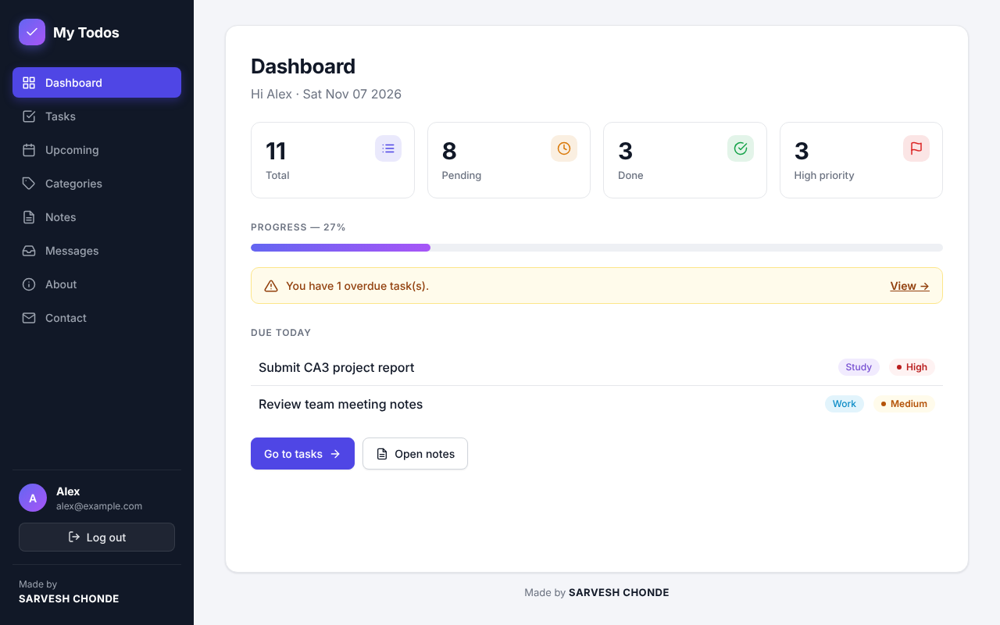

## Tech stack

| Part | Built with |
| --- | --- |
| **client** | React (Vite) with React Router, plain CSS, Inter font |
| **server** | Node.js (Express) REST API, JWT logins, bcrypt password hashing |
| **database** | MongoDB (any MongoDB you can open in MongoDB Compass, db `todoDb` by default) |

## Features

- Sign up and log in; every user only sees their own tasks and notes
- Add tasks with a category, priority and due date
- Filter (All / Pending / Done), search and sort tasks (newest, due date, priority)
- Edit a task's details and notes on its own page
- Dashboard with totals, progress, overdue warning and tasks due today
- Upcoming view grouping pending tasks into Overdue / Today / Upcoming / No due date
- Categories page with per-category progress
- Notes you can add, edit and delete
- Contact form anyone can use; logged in users can read the messages on the Messages page
- Colour-coded priorities (High / Medium / Low) and categories
- Works on phones: the sidebar becomes a top menu and task rows wrap

## Screenshots

<table>
  <tr>
    <td align="center" valign="top" width="50%"><b>Log in</b><br><br>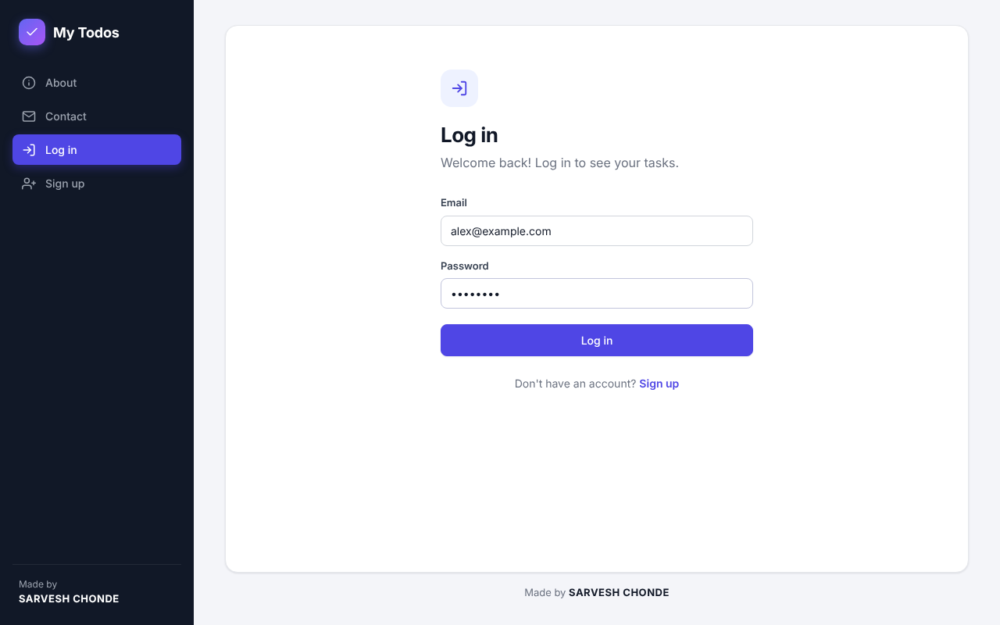</td>
    <td align="center" valign="top" width="50%"><b>Sign up</b><br><br>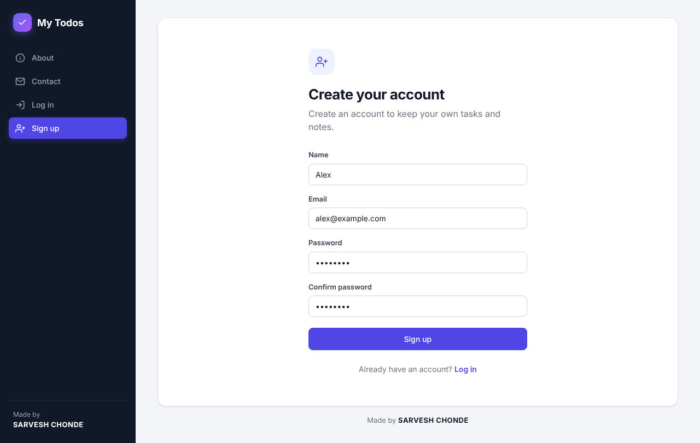</td>
  </tr>
  <tr>
    <td align="center" valign="top"><b>Tasks</b> – add, filter, search, sort and tick off tasks<br><br>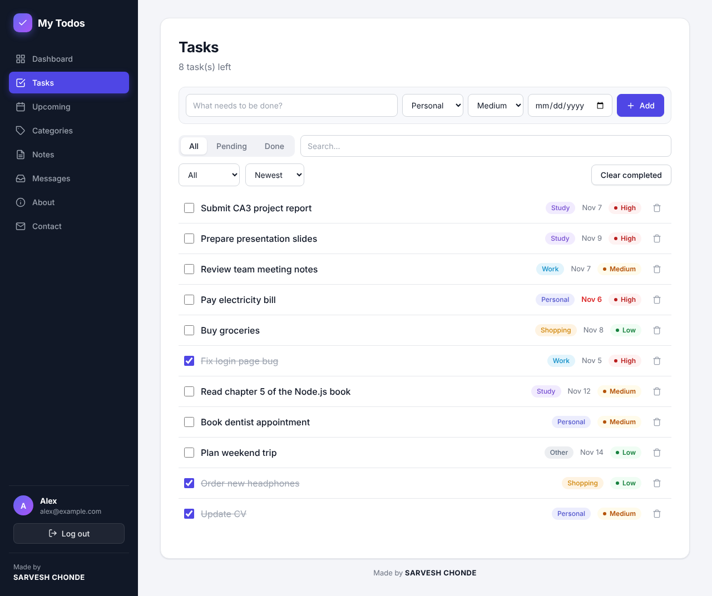</td>
    <td align="center" valign="top"><b>Edit task</b> – priority, category, due date and notes<br><br>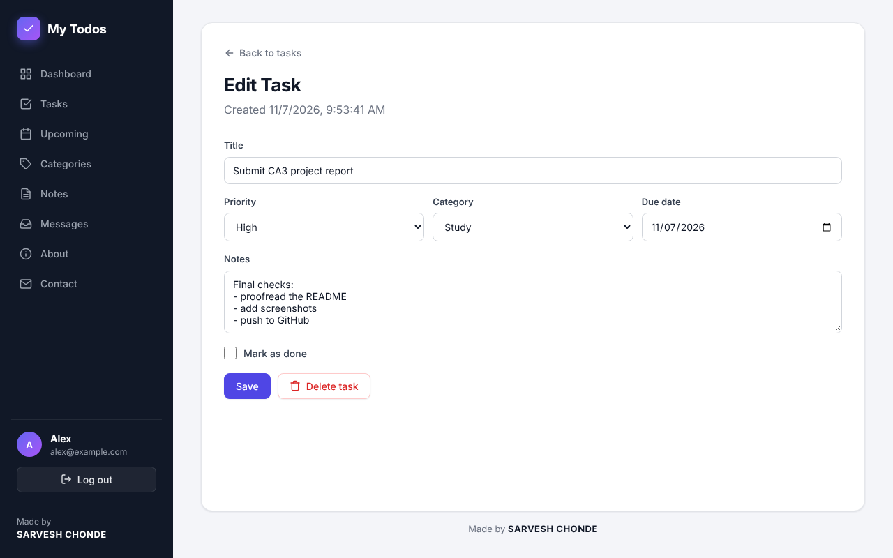</td>
  </tr>
  <tr>
    <td align="center" valign="top"><b>Upcoming</b> – pending tasks grouped by due date<br><br>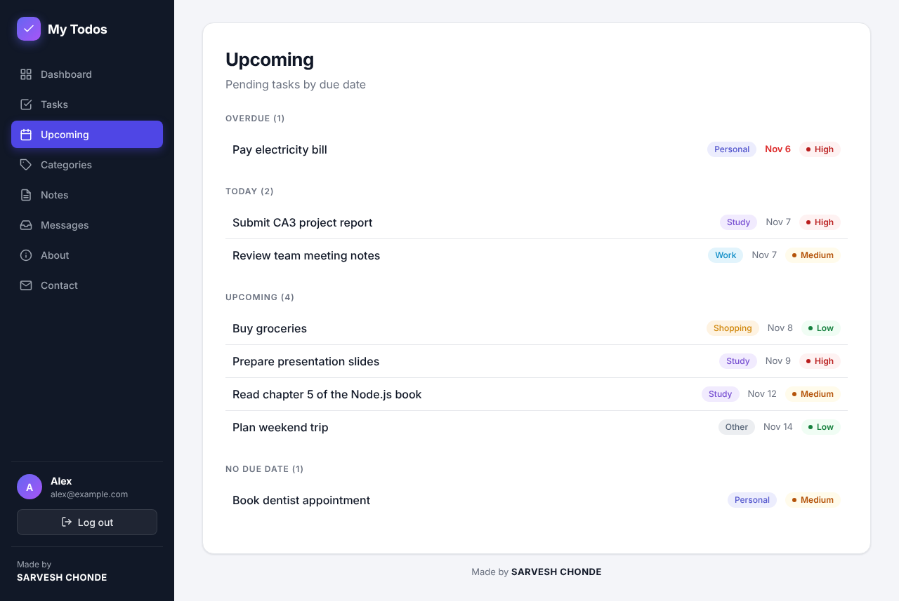</td>
    <td align="center" valign="top"><b>Categories</b> – progress per category<br><br>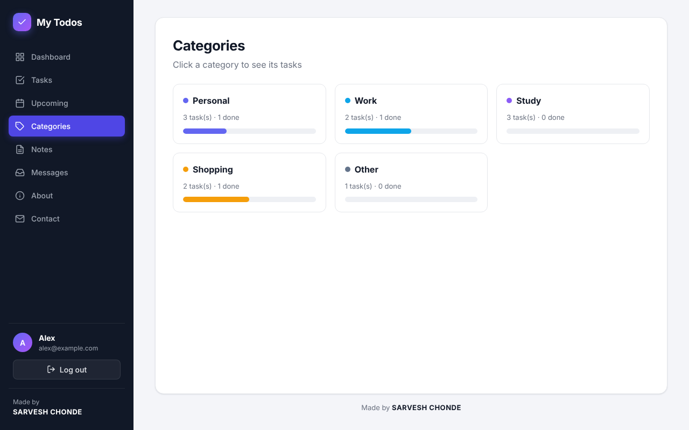</td>
  </tr>
  <tr>
    <td align="center" valign="top"><b>Notes</b><br><br>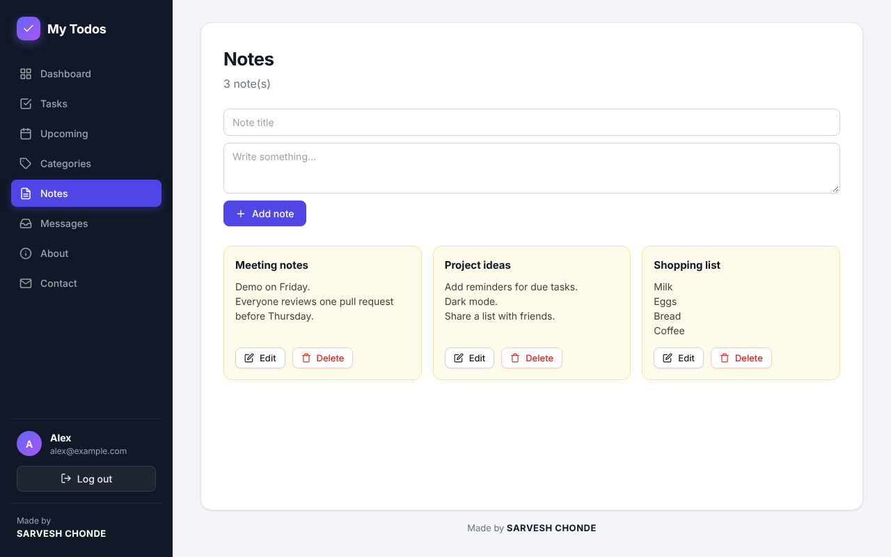</td>
    <td align="center" valign="top"><b>Messages</b> – sent from the contact page<br><br>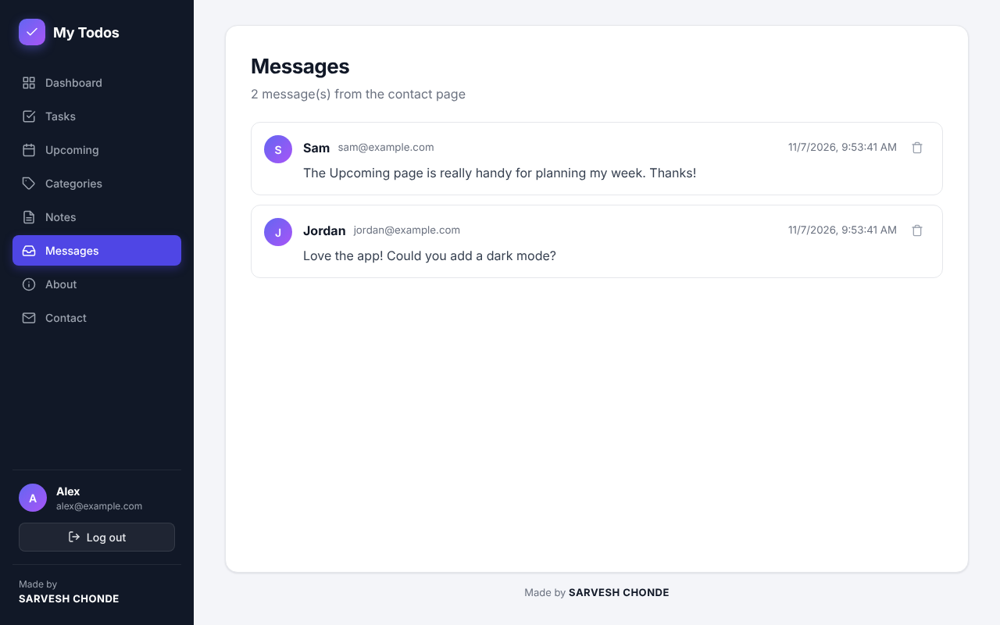</td>
  </tr>
  <tr>
    <td align="center" valign="top"><b>Contact</b><br><br>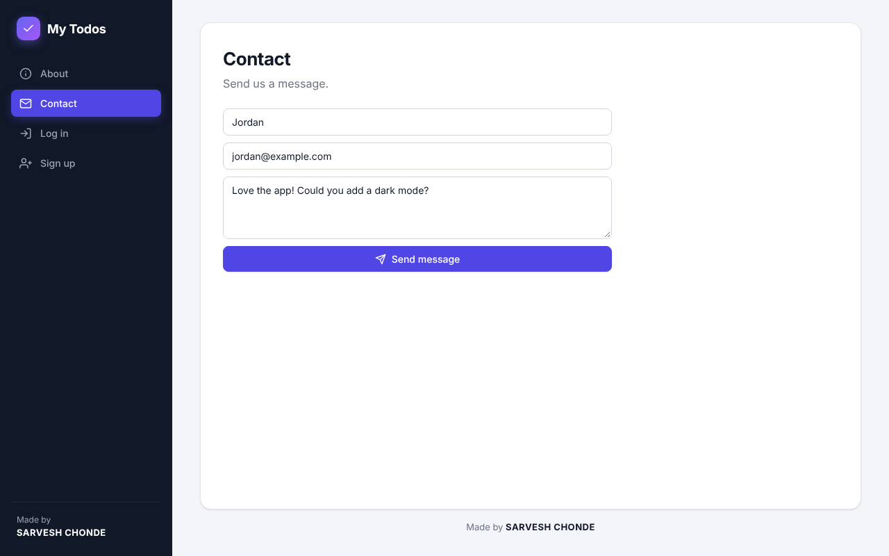</td>
    <td align="center" valign="top"><b>About</b><br><br>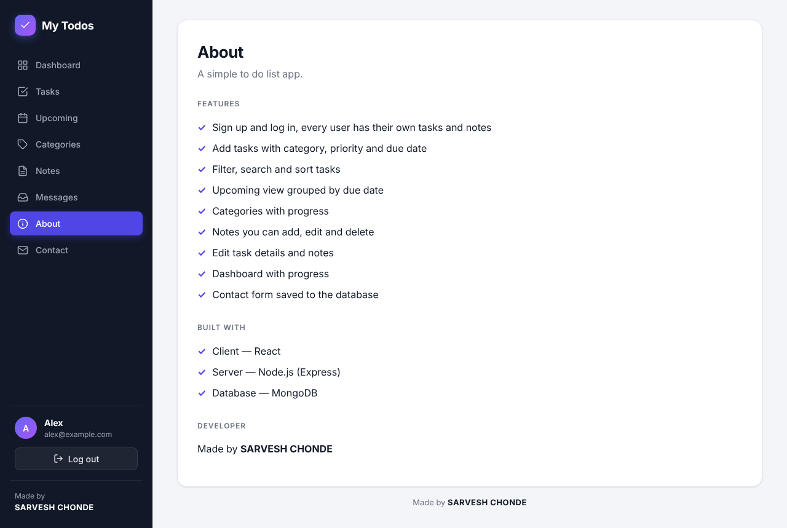</td>
  </tr>
  <tr>
    <td align="center" valign="top"><b>Phone – dashboard</b><br><br>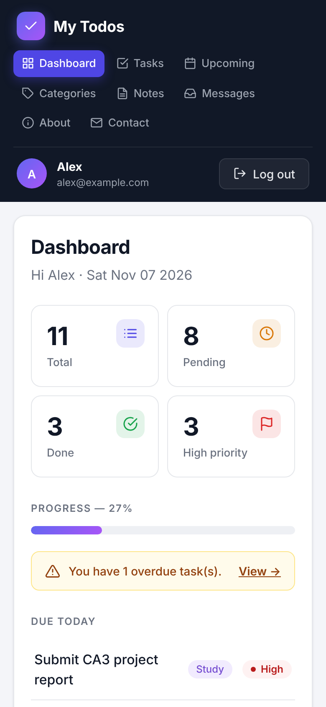</td>
    <td align="center" valign="top"><b>Phone – tasks</b><br><br>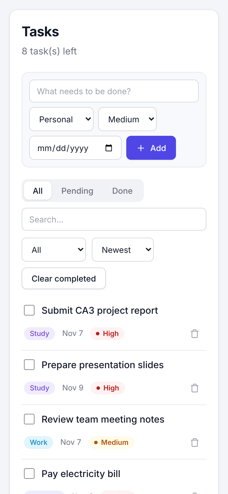</td>
  </tr>
</table>

## Prerequisites

- [Node.js](https://nodejs.org/) 20.19+ or 22.12+ (required by Vite and the MongoDB driver)
- A MongoDB database: a [local MongoDB](https://www.mongodb.com/try/download/community) or a free [MongoDB Atlas](https://www.mongodb.com/atlas) cluster
- [MongoDB Compass](https://www.mongodb.com/products/tools/compass) to look at the data

## Connect the database (MongoDB Compass)

The server reads its settings from `server/.env`, which is not committed to git. Create it from the example:

```
cd server
cp .env.example .env
```

Then fill in the empty values in `server/.env`:

- `MONGO_URI` – the same connection string you use to connect in MongoDB Compass.
  In Compass, click **Connect** on your connection and copy the URI, for example
  `mongodb://localhost:27017` (local) or `mongodb+srv://<username>:<password>@<cluster>.mongodb.net` (Atlas).
- `JWT_SECRET` – any long random string, used to sign login tokens. Generate one with
  `node -e "console.log(require('crypto').randomBytes(32).toString('hex'))"`.
- `DB_NAME` and `PORT` are optional (defaults: `todoDb` and `5000`).

The server will not start until `MONGO_URI` and `JWT_SECRET` are set. Once it is running and you have signed up,
refresh Compass to see the `todoDb` database with the `users`, `todos`, `notes` and `messages` collections.
Passwords are stored as bcrypt hashes in `users`, never as plain text.

## Run

Start the server (runs on http://localhost:5000):

```
cd server
npm install
npm start
```

Use `npm run dev` instead of `npm start` to restart the server automatically when files change.

In a second terminal, start the client (opens on http://localhost:5173):

```
cd client
npm install
npm run dev
```

Open http://localhost:5173, click **Sign up** to create an account, and you're in.

## Configuration

| Variable | Where | Default |
| --- | --- | --- |
| `MONGO_URI` | `server/.env` | none, required |
| `JWT_SECRET` | `server/.env` | none, required |
| `DB_NAME` | `server/.env` | `todoDb` |
| `PORT` | `server/.env` | `5000` |
| `VITE_API_URL` | client environment | `http://localhost:5000` |

If you change the server's `PORT`, point the client at it, e.g. `VITE_API_URL=http://localhost:5050 npm run dev`.

## API

All request and response bodies are JSON. Errors come back as `{ "msg": "..." }` with a `400` (invalid input),
`401` (not logged in / wrong password), `404` (not found) or `409` (email already registered) status.

`/signup` and `/login` return `{ token, user }`. Routes marked 🔒 need the token in an
`Authorization: Bearer <token>` header; tasks and notes are only ever those of the logged in user.

| Method | Route | Description |
| --- | --- | --- |
| POST | `/signup` | Create an account: `name`, `email`, `password` (at least 6 characters) |
| POST | `/login` | Log in: `email`, `password` |
| GET | `/me` 🔒 | The logged in user |
| GET | `/getall` 🔒 | All tasks, newest first |
| GET | `/get/:id` 🔒 | One task |
| POST | `/create` 🔒 | Create a task: `title` (required), `priority`, `dueDate`, `category`, `notes` |
| PUT | `/update/:id` 🔒 | Update any of `title`, `done`, `priority`, `dueDate`, `category`, `notes` |
| DELETE | `/delete/:id` 🔒 | Delete a task |
| DELETE | `/deleteCompleted` 🔒 | Delete all completed tasks |
| GET | `/notes` 🔒 | All notes, newest first |
| POST | `/notes` 🔒 | Create a note: `title` (required), `text` |
| PUT | `/notes/:id` 🔒 | Update a note: `title` (required), `text` |
| DELETE | `/notes/:id` 🔒 | Delete a note |
| GET | `/messages` 🔒 | All contact messages, newest first |
| POST | `/contact` | Send a message: `name`, `email`, `message` (all required) |
| DELETE | `/messages/:id` 🔒 | Delete a message |

`priority` is one of `Low`, `Medium`, `High`, and `category` is one of `Personal`, `Work`, `Study`, `Shopping`, `Other`.

## Project structure

```
├── client/                  React app (Vite)
│   ├── index.html
│   └── src/
│       ├── main.jsx         starts the app
│       ├── App.jsx          page routes (which ones need a login)
│       ├── auth.jsx         login state, log in / sign up / log out
│       ├── api.js           request helper and date helpers
│       ├── icons.jsx        line icons
│       ├── App.css          all the styles
│       └── *.jsx            one file per page (dashboard, tasks, notes, ...)
├── server/                  Express API
│   ├── server.js            routes, login checks, MongoDB queries
│   └── .env.example         settings to copy into .env
└── docs/screenshots/        the images in this README
```

## Development evidence

Screenshots taken while building the app (first version, before login was added).


### Evidence of the running app and development with the stack above

 


